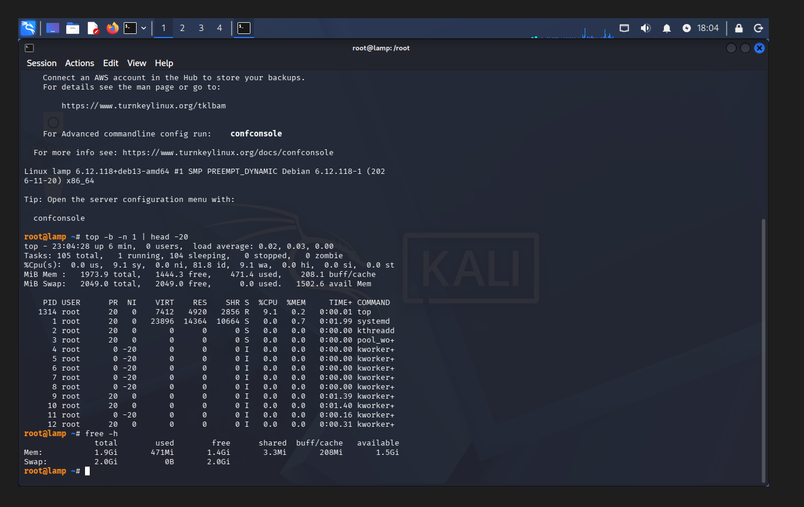
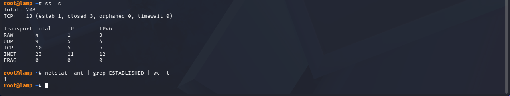
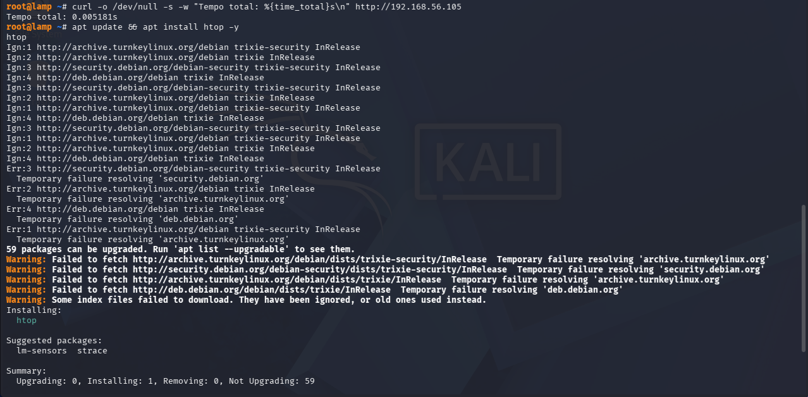
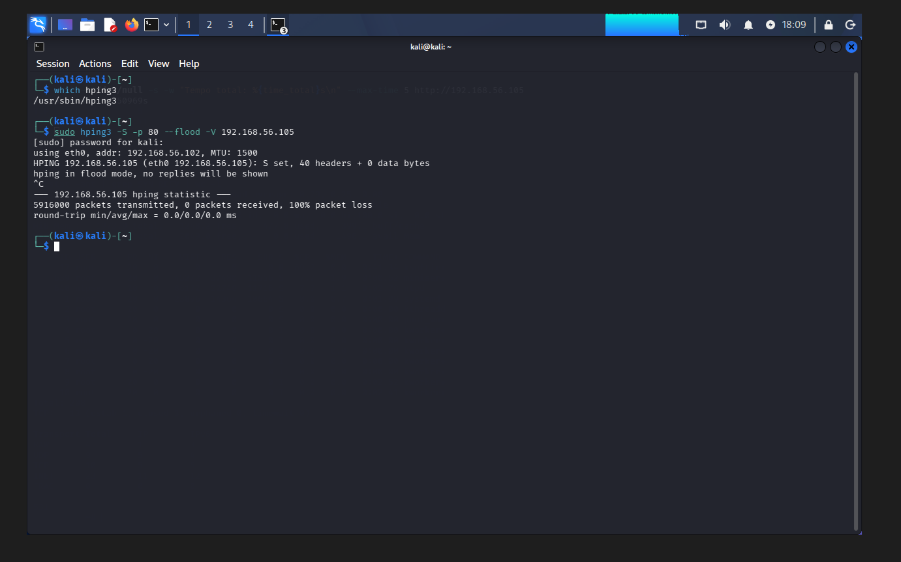
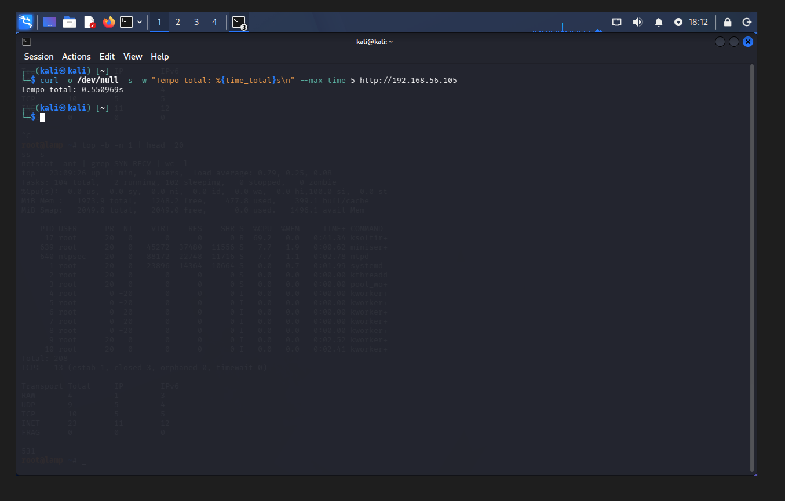
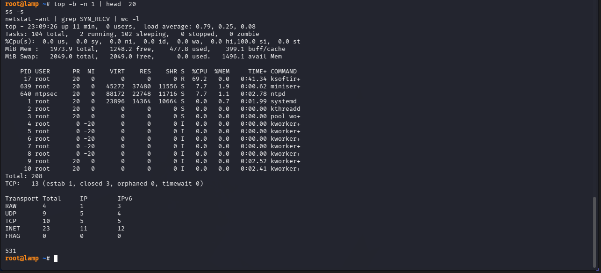
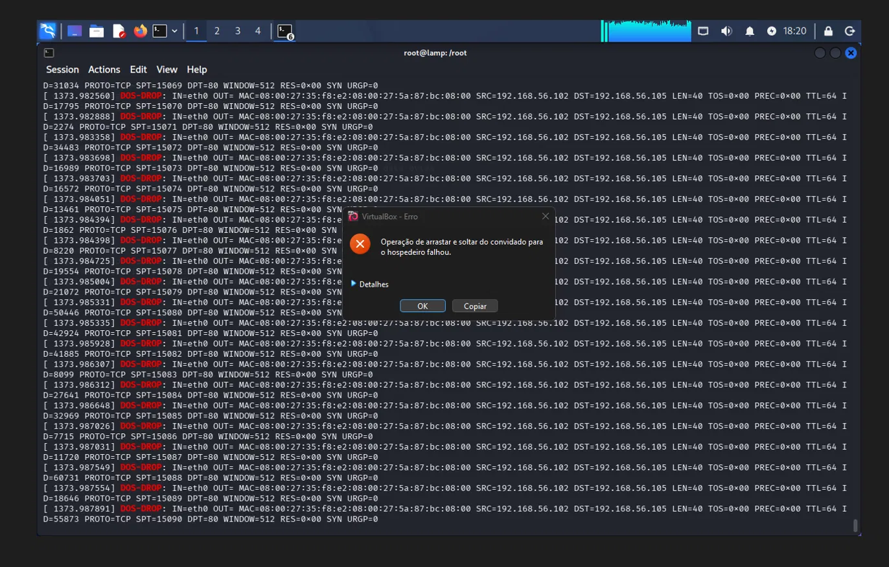

# Simulação de Ataque de Negação de Serviço (DoS) e Implementação de Defesa com Firewall

Atividade prática da disciplina **Segurança da Informação** — IFTM Campus Patrocínio.

## Objetivo

Demonstrar, em ambiente virtualizado estritamente isolado (rede Host-Only, sem acesso externo), o impacto de um ataque de Negação de Serviço (DoS) do tipo **SYN Flood** contra um servidor web, e validar a eficácia de uma mitigação baseada em **firewall com rate limiting por IP de origem** e **SYN cookies**.

---

## 1. Topologia do Laboratório

| Máquina | Papel | IP | Sistema |
|---|---|---|---|
| Kali Linux | Atacante | `192.168.56.102` | Kali Linux 2026.2 |
| TurnKey LAMP | Alvo (servidor web) | `192.168.56.105` | TurnKey LAMP 19.0.5 (Debian 13/Trixie) |

**Rede:** Adaptador Exclusivo do Hospedeiro (Host-Only), sem NAT ou Bridge em nenhuma das duas VMs — rede isolada, sem acesso à internet.

**Evidência de isolamento:** tentativas de `apt install` na máquina alvo falharam com `Temporary failure resolving 'deb.debian.org'`, confirmando que não há rota para a internet a partir do ambiente de laboratório.

> *(Inserir aqui o print da topologia: VirtualBox Manager mostrando as duas VMs, e o print do `ping` + `curl` bem-sucedido entre Kali e TurnKey confirmando a conectividade na rede isolada.)*

---

## 2. Preparação do Ambiente

### 2.1 Máquina Alvo (TurnKey LAMP)

- Instalada via ISO oficial (`turnkey-lamp-19.0.5-trixie-amd64.iso`) em VM VirtualBox (2 vCPU, ~2 GB RAM, 20 GB disco, partições ext4 + swap).
- Serviços padrão: Apache (porta 80/443), MySQL/MariaDB, Webmin (12321), Adminer (12322).

### 2.2 Máquina Atacante (Kali Linux)

- VM Kali Linux 2026.2 já existente, configurada na mesma rede host-only.
- Ferramenta de ataque: `hping3` (já disponível por padrão na Kali).

---

## 3. Estado Base (Baseline) — Antes do Ataque

Comandos executados na máquina alvo via SSH:

```bash
top -b -n 1 | head -20
free -h
ss -s
netstat -ant | grep ESTABLISHED | wc -l
```

E, a partir da Kali, medição do tempo de resposta HTTP:

```bash
curl -o /dev/null -s -w "Tempo total: %{time_total}s\n" http://192.168.56.105
```

### Resultados do Baseline

| Métrica | Valor |
|---|---|
| Load average | 0.02, 0.03, 0.00 |
| CPU idle | 81.8% |
| Memória usada | 471 MB / 1.9 GB (17.6%) |
| Conexões TCP estabelecidas | 1 |
| Tempo de resposta HTTP | 0.005s |







---

## 4. Simulação do Ataque (SYN Flood com hping3)

Comando executado na Kali contra a porta 80 do alvo:

```bash
sudo hping3 -S -p 80 --flood -V 192.168.56.105
```

- `-S`: ativa a flag SYN
- `-p 80`: porta de destino (HTTP)
- `--flood`: envia pacotes o mais rápido possível, sem esperar resposta
- `-V`: modo verboso

Durante o ataque, monitoramento em paralelo na máquina alvo:

```bash
top -b -n 1 | head -20
ss -s
netstat -ant | grep SYN_RECV | wc -l
```

### Resultados Durante o Ataque (sem mitigação)

| Métrica | Baseline | Durante o ataque |
|---|---|---|
| Load average | 0.02 | **0.79** |
| CPU | 81.8% idle | **100% em softirq** |
| Conexões SYN_RECV (meio-abertas) | 0 | **531** |
| Tempo de resposta HTTP | 0.005s | **0.55s** (chegando a 5s/timeout em testes subsequentes) |
| Pacotes SYN enviados pelo atacante | — | ~5,9 milhões em segundos |







**Conclusão da Etapa 1:** o ataque SYN Flood esgotou os recursos de processamento de interrupções de rede (softirq) e lotou a fila de conexões semiabertas (SYN_RECV), degradando significativamente o tempo de resposta do servidor.

---

## 5. Implementação da Defesa com Firewall

### 5.1 SYN Cookies (nível de kernel)

```bash
sysctl -w net.ipv4.tcp_syncookies=1
echo "net.ipv4.tcp_syncookies = 1" >> /etc/sysctl.conf
sysctl -p
```

Permite que o kernel responda a conexões SYN sem alocar recursos reais até a confirmação do handshake, mitigando o esgotamento de memória do backlog de conexões.

### 5.2 Regras de iptables (rate limiting por IP de origem + connlimit)

> **Observação técnica:** a primeira tentativa de mitigação usou o módulo `limit` padrão, que aplica uma cota **global** (soma de todos os IPs). Isso causou falso negativo: o próprio atacante consumia toda a cota disponível, impedindo também requisições legítimas de passar. A correção foi usar o módulo **`hashlimit`** com `--hashlimit-mode srcip`, que aplica a cota **por IP de origem individualmente**.

```bash
# Pacotes SYN que excedem 10/s POR IP DE ORIGEM são logados e descartados
iptables -A INPUT -p tcp --syn --dport 80 -m hashlimit \
  --hashlimit-above 10/sec --hashlimit-burst 20 \
  --hashlimit-mode srcip --hashlimit-name synflood \
  -j LOG --log-prefix "DOS-DROP: "

iptables -A INPUT -p tcp --syn --dport 80 -m hashlimit \
  --hashlimit-above 10/sec --hashlimit-burst 20 \
  --hashlimit-mode srcip --hashlimit-name synflood \
  -j DROP

# IPs dentro da cota individual são aceitos normalmente
iptables -A INPUT -p tcp --syn --dport 80 -j ACCEPT

# Limite de conexões simultâneas por IP (anti-monopolização)
iptables -A INPUT -p tcp --dport 80 -m connlimit --connlimit-above 20 -j DROP
```

### 5.3 Regras aplicadas (`iptables -L -v -n`)

```
Chain INPUT (policy ACCEPT 11420 packets, 762K bytes)
 pkts bytes target     prot opt in     out     source               destination
 223K 8925K LOG        tcp  --  *      *       0.0.0.0/0            0.0.0.0/0    tcp dpt:80 flags:0x17/0x02 limit: above 10/sec burst 20 mode srcip LOG flags 0 level 4 prefix "DOS-DROP: "
 224K 8949K DROP       tcp  --  *      *       0.0.0.0/0            0.0.0.0/0    tcp dpt:80 flags:0x17/0x02 limit: above 10/sec burst 20 mode srcip
   20   800 ACCEPT     tcp  --  *      *       0.0.0.0/0            0.0.0.0/0    tcp dpt:80 flags:0x17/0x02
    0     0 DROP       tcp  --  *      *       0.0.0.0/0            0.0.0.0/0    tcp dpt:80 #conn src/32 > 20
```

### 5.4 Logs do firewall (pacotes descartados)

Monitoramento em tempo real:
```bash
dmesg -w | grep DOS-DROP
```

Exemplo de log capturado durante o ataque:
```
[1373.982560] DOS-DROP: IN=eth0 OUT= MAC=08:00:27:35:f8:e2:08:00:27:5a:87:bc:08:00 SRC=192.168.56.102 DST=192.168.56.105 LEN=40 TOS=0x00 PREC=0x00 TTL=64 ID=31034 PROTO=TCP SPT=15069 DPT=80 WINDOW=512 RES=0x00 SYN URGP=0
```



---

## 6. Validação da Mitigação (Reteste do Ataque)

Com o firewall ativo, o ataque foi disparado novamente:

```bash
sudo hping3 -S -p 80 --flood -V 192.168.56.105
```

E, durante o ataque ainda em andamento, o teste de disponibilidade:

```bash
curl -o /dev/null -s -w "Tempo total: %{time_total}s\n" --max-time 5 http://192.168.56.105
```

### Resultado

| Métrica | Baseline | Ataque sem firewall | Ataque com firewall mitigado |
|---|---|---|---|
| Tempo de resposta HTTP | 0.005s | 0.55s (chegando a timeout de 5s) | **0.000000s** |
| Pacotes de ataque descartados (contador iptables) | — | — | **224.000+** |

**Conclusão da Etapa 2:** mesmo com o ataque SYN Flood ativo e descartando constantemente pacotes do IP atacante, o serviço HTTP permaneceu disponível e respondendo rapidamente, confirmando a eficácia da combinação de SYN cookies + rate limiting por IP (hashlimit) + connlimit.

---

## 7. Conclusão Geral

O laboratório demonstrou, de forma controlada e isolada, como um ataque de Negação de Serviço do tipo SYN Flood pode degradar severamente a disponibilidade de um serviço web (aumento de ~100x no tempo de resposta, esgotamento de CPU em processamento de interrupções, centenas de conexões semiabertas). A implementação de um firewall com SYN cookies e rate limiting por IP de origem (hashlimit) restabeleceu a disponibilidade do serviço mesmo sob ataque contínuo, evidenciando a importância de mecanismos de defesa em profundidade contra ataques volumétricos.

---

## Observações Éticas

Este laboratório foi executado em ambiente estritamente isolado (rede Host-Only do VirtualBox, sem acesso externo), com máquinas de propriedade do próprio autor, exclusivamente para fins educacionais no contexto da disciplina de Segurança da Informação. Nenhum sistema de terceiros foi afetado.


Link do vídeo do YouTube: https://youtu.be/6RZW6SyqICM
